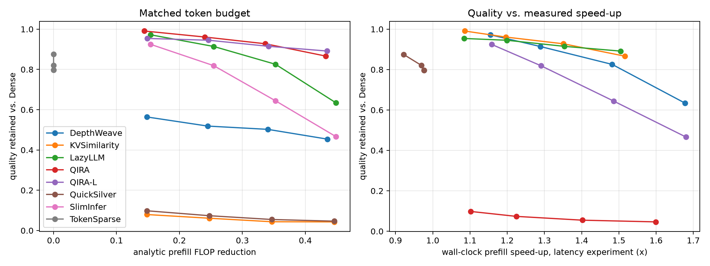
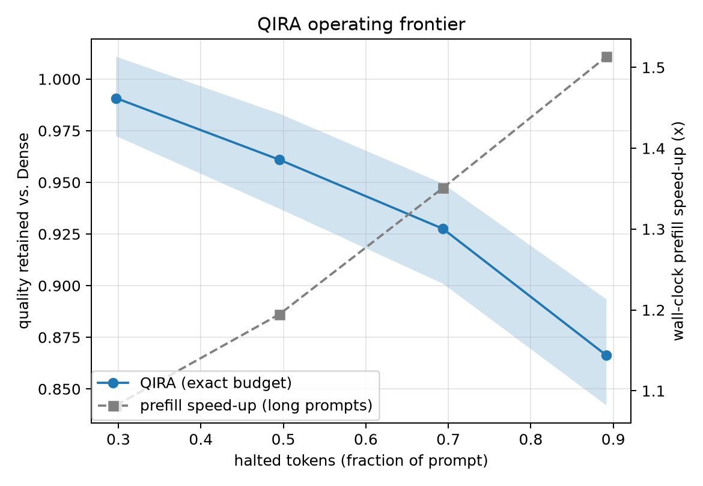

# QIRA report — Qwen2.5-7B-Instruct

Protocol `QIRA-v8-transport` · preset `paper` · calibration source `natural` · decision layer 14 / 28

QIRA is backbone-frozen and inference-time adaptive; its K/V transport maps are calibrated offline in closed form on a pool disjoint from all evaluation data.

## 1. The problem: cross-layer K/V mismatch (calibration hold-out)

Mean held-out NMSE of halted-token K/V over all layers after the halting layer (`ridge(sub)`/`mlp` are measured on the MLP subsample).

| policy      |   nmse_kv |
|:------------|----------:|
| stale       |    2.7578 |
| reproject   |    0.3322 |
| mlp         |    0.1410 |
| ridge(sub)  |    0.1235 |
| ridge_layer |    0.1232 |
| ridge       |    0.1231 |
| ridge_plain |    0.1225 |

Spearman correlation of each selector score with (a) low halting harm, harm = attention received x ridge transport error summed over layers >= d, and (b) transportability (−log ridge NMSE):

| selector              |   spearman_vs_low_harm |   spearman_vs_transportability |
|:----------------------|-----------------------:|-------------------------------:|
| qei                   |                  0.071 |                         -0.035 |
| qei_equal             |                  0.086 |                         -0.041 |
| qei_no_purity         |                  0.100 |                         -0.046 |
| qei_no_rank           |                  0.090 |                         -0.042 |
| qei_no_gap            |                  0.073 |                         -0.035 |
| qei_no_stability      |                  0.001 |                         -0.003 |
| qei_exact             |                  0.028 |                         -0.024 |
| cosine                |                  0.134 |                         -0.023 |
| normdelta             |                  0.098 |                         -0.105 |
| drift                 |                  0.017 |                          0.321 |
| lastattn              |                  0.198 |                          0.002 |
| relnorm               |                  0.006 |                         -0.183 |
| random                |                  0.010 |                         -0.003 |
| qei_fit               |                  0.119 |                         -0.052 |
| learned               |                  0.451 |                          0.123 |
| feature:purity        |                 -0.001 |                         -0.002 |
| feature:rank_score    |                 -0.001 |                         -0.002 |
| feature:gap           |                  0.019 |                         -0.011 |
| feature:stability     |                  0.122 |                         -0.055 |
| feature:cosine        |                  0.134 |                         -0.023 |
| feature:neg_normdelta |                  0.098 |                         -0.105 |
| feature:neg_drift     |                  0.017 |                          0.321 |
| feature:neg_relnorm   |                  0.006 |                         -0.183 |
| feature:neg_lastattn  |                  0.198 |                          0.002 |
| feature:rel_pos       |                  0.395 |                          0.062 |

## 2. Matched token-reduction budget

Dense: 3218 samples; mean Dense prefill 0.171s; engine-vs-HF KL (sanity) nan.

| method       |   budget |    n |   halt_frac |   flop_reduction |   retention |   retention_lo |   retention_hi |   kl_last |   top1_agree |   fidelity |   speedup_long_median |   speedup_latency |
|:-------------|---------:|-----:|------------:|-----------------:|------------:|---------------:|---------------:|----------:|-------------:|-----------:|----------------------:|------------------:|
| DepthWeave   |    0.300 | 3218 |       0.298 |            0.149 |       0.564 |          0.536 |          0.601 |     1.708 |        0.562 |      0.319 |                 0.528 |           nan     |
| KVSimilarity |    0.300 | 3218 |       0.297 |            0.149 |       0.079 |          0.071 |          0.088 |     5.926 |        0.125 |      0.046 |                 1.105 |           nan     |
| LazyLLM      |    0.300 | 3218 |       0.297 |            0.154 |       0.972 |          0.959 |          0.985 |     0.094 |        0.945 |      0.821 |                 1.156 |             1.155 |
| QIRA         |    0.300 | 3218 |       0.297 |            0.144 |       0.991 |          0.972 |          1.011 |     0.184 |        0.878 |      0.707 |                 1.082 |             1.086 |
| QIRA-L       |    0.300 | 3218 |       0.297 |            0.149 |       0.954 |          0.935 |          0.971 |     0.165 |        0.907 |      0.777 |                 1.084 |             1.085 |
| QuickSilver  |    0.300 | 3218 |       0.297 |            0.148 |       0.098 |          0.091 |          0.108 |     5.629 |        0.117 |      0.053 |                 1.103 |             1.102 |
| SlimInfer    |    0.300 | 3218 |       0.297 |            0.154 |       0.925 |          0.897 |          0.951 |     0.850 |        0.707 |      0.556 |                 1.161 |             1.158 |
| TokenSparse  |    0.300 | 3218 |       0.000 |            0.000 |       0.875 |          0.850 |          0.898 |     0.882 |        0.687 |      0.456 |                 0.909 |             0.921 |
| DepthWeave   |    0.500 | 3218 |       0.497 |            0.245 |       0.519 |          0.492 |          0.552 |     1.827 |        0.533 |      0.288 |                 0.590 |           nan     |
| KVSimilarity |    0.500 | 3218 |       0.495 |            0.248 |       0.061 |          0.056 |          0.067 |     6.388 |        0.101 |      0.034 |                 1.225 |           nan     |
| LazyLLM      |    0.500 | 3218 |       0.495 |            0.255 |       0.914 |          0.895 |          0.935 |     0.296 |        0.897 |      0.715 |                 1.291 |             1.289 |
| QIRA         |    0.500 | 3218 |       0.495 |            0.240 |       0.961 |          0.937 |          0.983 |     0.358 |        0.822 |      0.638 |                 1.195 |             1.196 |
| QIRA-L       |    0.500 | 3218 |       0.495 |            0.246 |       0.945 |          0.924 |          0.967 |     0.337 |        0.861 |      0.700 |                 1.198 |             1.199 |
| QuickSilver  |    0.500 | 3218 |       0.495 |            0.247 |       0.074 |          0.068 |          0.081 |     6.105 |        0.113 |      0.041 |                 1.223 |             1.225 |
| SlimInfer    |    0.500 | 3218 |       0.495 |            0.255 |       0.819 |          0.785 |          0.847 |     1.737 |        0.598 |      0.443 |                 1.295 |             1.291 |
| TokenSparse  |    0.500 | 3218 |       0.000 |            0.000 |       0.821 |          0.795 |          0.847 |     1.224 |        0.638 |      0.402 |                 0.968 |             0.969 |
| DepthWeave   |    0.700 | 3218 |       0.695 |            0.340 |       0.502 |          0.476 |          0.538 |     1.947 |        0.498 |      0.262 |                 0.672 |           nan     |
| KVSimilarity |    0.700 | 3218 |       0.694 |            0.347 |       0.044 |          0.039 |          0.049 |     6.727 |        0.089 |      0.027 |                 1.405 |           nan     |
| LazyLLM      |    0.700 | 3218 |       0.694 |            0.353 |       0.826 |          0.803 |          0.850 |     0.792 |        0.821 |      0.591 |                 1.484 |             1.482 |
| QIRA         |    0.700 | 3218 |       0.694 |            0.336 |       0.928 |          0.901 |          0.949 |     0.646 |        0.765 |      0.560 |                 1.351 |             1.351 |
| QIRA-L       |    0.700 | 3218 |       0.694 |            0.341 |       0.915 |          0.894 |          0.937 |     0.517 |        0.818 |      0.631 |                 1.352 |             1.354 |
| QuickSilver  |    0.700 | 3218 |       0.694 |            0.347 |       0.055 |          0.050 |          0.061 |     6.535 |        0.098 |      0.032 |                 1.403 |             1.402 |
| SlimInfer    |    0.700 | 3218 |       0.694 |            0.353 |       0.644 |          0.616 |          0.674 |     2.709 |        0.466 |      0.335 |                 1.488 |             1.486 |
| TokenSparse  |    0.700 | 3218 |       0.000 |            0.000 |       0.797 |          0.767 |          0.825 |     1.286 |        0.622 |      0.394 |                 0.977 |             0.976 |
| DepthWeave   |    0.900 | 3218 |       0.894 |            0.435 |       0.454 |          0.428 |          0.484 |     2.108 |        0.442 |      0.234 |                 0.756 |           nan     |
| KVSimilarity |    0.900 | 3218 |       0.892 |            0.446 |       0.043 |          0.039 |          0.048 |     7.228 |        0.082 |      0.024 |                 1.594 |           nan     |
| LazyLLM      |    0.900 | 3218 |       0.892 |            0.448 |       0.634 |          0.604 |          0.664 |     2.069 |        0.676 |      0.408 |                 1.676 |             1.677 |
| QIRA         |    0.900 | 3218 |       0.892 |            0.433 |       0.866 |          0.842 |          0.893 |     0.909 |        0.713 |      0.489 |                 1.513 |             1.516 |
| QIRA-L       |    0.900 | 3218 |       0.892 |            0.435 |       0.891 |          0.869 |          0.917 |     0.658 |        0.787 |      0.562 |                 1.501 |             1.505 |
| QuickSilver  |    0.900 | 3218 |       0.892 |            0.446 |       0.046 |          0.042 |          0.052 |     7.322 |        0.062 |      0.027 |                 1.592 |             1.599 |
| SlimInfer    |    0.900 | 3218 |       0.892 |            0.448 |       0.467 |          0.443 |          0.498 |     4.390 |        0.321 |      0.229 |                 1.682 |             1.680 |
| TokenSparse  |    0.900 | 3218 |       0.000 |            0.000 |       0.797 |          0.767 |          0.825 |     1.286 |        0.622 |      0.394 |                 0.977 |             0.976 |

## 3. Matched quality (accuracy-matched efficiency)

Largest efficiency at which each method still retains the target fraction of Dense quality (linear interpolation along the budget sweep; `saturated` = target still met at the largest budget tested, so the value is a lower bound).

| method       |   target |   flop_reduction |   halt_frac |   speedup_long_median |   speedup_latency | reached   | saturated   |
|:-------------|---------:|-----------------:|------------:|----------------------:|------------------:|:----------|:------------|
| DepthWeave   |    0.990 |            0.000 |       0.000 |                 0.000 |             0.000 | False     | False       |
| DepthWeave   |    0.970 |            0.000 |       0.000 |                 0.000 |             0.000 | False     | False       |
| DepthWeave   |    0.950 |            0.000 |       0.000 |                 0.000 |             0.000 | False     | False       |
| DepthWeave   |    0.900 |            0.000 |       0.000 |                 0.000 |             0.000 | False     | False       |
| DepthWeave   |    0.850 |            0.000 |       0.000 |                 0.000 |             0.000 | False     | False       |
| KVSimilarity |    0.990 |            0.000 |       0.000 |                 0.000 |             0.000 | False     | False       |
| KVSimilarity |    0.970 |            0.000 |       0.000 |                 0.000 |             0.000 | False     | False       |
| KVSimilarity |    0.950 |            0.000 |       0.000 |                 0.000 |             0.000 | False     | False       |
| KVSimilarity |    0.900 |            0.000 |       0.000 |                 0.000 |             0.000 | False     | False       |
| KVSimilarity |    0.850 |            0.000 |       0.000 |                 0.000 |             0.000 | False     | False       |
| LazyLLM      |    0.990 |            0.000 |       0.000 |                 0.000 |             0.000 | False     | False       |
| LazyLLM      |    0.970 |            0.158 |       0.304 |                 1.161 |             1.160 | True      | False       |
| LazyLLM      |    0.950 |            0.192 |       0.372 |                 1.207 |             1.206 | True      | False       |
| LazyLLM      |    0.900 |            0.270 |       0.527 |                 1.322 |             1.320 | True      | False       |
| LazyLLM      |    0.850 |            0.326 |       0.639 |                 1.431 |             1.429 | True      | False       |
| QIRA         |    0.990 |            0.147 |       0.302 |                 1.085 |             1.089 | True      | False       |
| QIRA         |    0.970 |            0.211 |       0.435 |                 1.160 |             1.163 | True      | False       |
| QIRA         |    0.950 |            0.272 |       0.560 |                 1.246 |             1.247 | True      | False       |
| QIRA         |    0.900 |            0.380 |       0.783 |                 1.424 |             1.425 | True      | False       |
| QIRA         |    0.850 |            0.433 |       0.892 |                 1.513 |             1.516 | True      | True        |
| QIRA-L       |    0.990 |            0.000 |       0.000 |                 0.000 |             0.000 | False     | False       |
| QIRA-L       |    0.970 |            0.000 |       0.000 |                 0.000 |             0.000 | False     | False       |
| QIRA-L       |    0.950 |            0.192 |       0.385 |                 1.135 |             1.135 | True      | False       |
| QIRA-L       |    0.900 |            0.401 |       0.819 |                 1.446 |             1.450 | True      | False       |
| QIRA-L       |    0.850 |            0.435 |       0.892 |                 1.501 |             1.505 | True      | True        |
| QuickSilver  |    0.990 |            0.000 |       0.000 |                 0.000 |             0.000 | False     | False       |
| QuickSilver  |    0.970 |            0.000 |       0.000 |                 0.000 |             0.000 | False     | False       |
| QuickSilver  |    0.950 |            0.000 |       0.000 |                 0.000 |             0.000 | False     | False       |
| QuickSilver  |    0.900 |            0.000 |       0.000 |                 0.000 |             0.000 | False     | False       |
| QuickSilver  |    0.850 |            0.000 |       0.000 |                 0.000 |             0.000 | False     | False       |
| SlimInfer    |    0.990 |            0.000 |       0.000 |                 0.000 |             0.000 | False     | False       |
| SlimInfer    |    0.970 |            0.000 |       0.000 |                 0.000 |             0.000 | False     | False       |
| SlimInfer    |    0.950 |            0.000 |       0.000 |                 0.000 |             0.000 | False     | False       |
| SlimInfer    |    0.900 |            0.178 |       0.343 |                 1.192 |             1.189 | True      | False       |
| SlimInfer    |    0.850 |            0.225 |       0.437 |                 1.255 |             1.252 | True      | False       |
| TokenSparse  |    0.990 |            0.000 |       0.000 |                 0.000 |             0.000 | False     | False       |
| TokenSparse  |    0.970 |            0.000 |       0.000 |                 0.000 |             0.000 | False     | False       |
| TokenSparse  |    0.950 |            0.000 |       0.000 |                 0.000 |             0.000 | False     | False       |
| TokenSparse  |    0.900 |            0.000 |       0.000 |                 0.000 |             0.000 | False     | False       |
| TokenSparse  |    0.850 |            0.000 |       0.000 |                 0.909 |             0.921 | True      | False       |

## 4. QIRA operating frontier

_(not run)_

## 4b. Decomposition: plugging QIRA transport into baseline selectors (`+T` = same selector, ridge transport); QIRA vs QIRA-L = QEI vs learned selector

|   budget | base   | variant   |   retention_base |   retention_variant |   kl_base |   kl_variant |
|---------:|:-------|:----------|-----------------:|--------------------:|----------:|-------------:|
|    0.300 | QIRA   | QIRA-L    |            0.991 |               0.954 |     0.184 |        0.165 |
|    0.500 | QIRA   | QIRA-L    |            0.961 |               0.945 |     0.358 |        0.337 |
|    0.700 | QIRA   | QIRA-L    |            0.928 |               0.915 |     0.646 |        0.517 |
|    0.900 | QIRA   | QIRA-L    |            0.866 |               0.891 |     0.909 |        0.658 |

## 4c. Wall-clock prefill latency (LongBench prompts >= 2K tokens; warm-up + median of repeats; no generation)

| method      |   budget |   n |   prompt_tokens |   halt_frac |   flop_reduction |   prefill_s |   prefill_dense |   speedup |   speedup_p25 |   speedup_p75 |   kl_last | attn_mode    |
|:------------|---------:|----:|----------------:|------------:|-----------------:|------------:|----------------:|----------:|--------------:|--------------:|----------:|:-------------|
| LazyLLM     |    0.300 |   8 |        4053.500 |       0.298 |            0.155 |       0.160 |           0.185 |     1.155 |         1.153 |         1.175 |     0.131 | compact      |
| LazyLLM     |    0.500 |   8 |        4053.500 |       0.496 |            0.255 |       0.143 |           0.185 |     1.289 |         1.287 |         1.328 |     1.105 | compact      |
| LazyLLM     |    0.700 |   8 |        4053.500 |       0.695 |            0.353 |       0.125 |           0.185 |     1.482 |         1.480 |         1.500 |     2.508 | compact      |
| LazyLLM     |    0.900 |   8 |        4053.500 |       0.893 |            0.449 |       0.110 |           0.185 |     1.677 |         1.672 |         1.698 |     5.350 | compact      |
| QIRA        |    0.300 |   8 |        4053.500 |       0.298 |            0.145 |       0.170 |           0.185 |     1.086 |         1.083 |         1.107 |     0.096 | flex         |
| QIRA        |    0.500 |   8 |        4053.500 |       0.496 |            0.241 |       0.154 |           0.185 |     1.196 |         1.192 |         1.237 |     0.610 | flex         |
| QIRA        |    0.700 |   8 |        4053.500 |       0.695 |            0.337 |       0.137 |           0.185 |     1.351 |         1.347 |         1.371 |     1.601 | flex         |
| QIRA        |    0.900 |   8 |        4053.500 |       0.893 |            0.433 |       0.122 |           0.185 |     1.516 |         1.512 |         1.539 |     3.088 | flex         |
| QIRA-L      |    0.300 |   8 |        4053.500 |       0.298 |            0.150 |       0.170 |           0.185 |     1.085 |         1.082 |         1.105 |     0.275 | flex         |
| QIRA-L      |    0.500 |   8 |        4053.500 |       0.496 |            0.247 |       0.154 |           0.185 |     1.199 |         1.192 |         1.237 |     0.804 | flex         |
| QIRA-L      |    0.700 |   8 |        4053.500 |       0.695 |            0.342 |       0.137 |           0.185 |     1.354 |         1.352 |         1.368 |     1.569 | flex         |
| QIRA-L      |    0.900 |   8 |        4053.500 |       0.893 |            0.436 |       0.123 |           0.185 |     1.505 |         1.495 |         1.526 |     1.812 | flex         |
| QuickSilver |    0.300 |   8 |        4053.500 |       0.298 |            0.149 |       0.168 |           0.185 |     1.102 |         1.101 |         1.125 |     7.532 | flex         |
| QuickSilver |    0.500 |   8 |        4053.500 |       0.496 |            0.248 |       0.151 |           0.185 |     1.225 |         1.221 |         1.266 |     8.644 | flex         |
| QuickSilver |    0.700 |   8 |        4053.500 |       0.695 |            0.347 |       0.132 |           0.185 |     1.402 |         1.400 |         1.421 |    11.001 | flex         |
| QuickSilver |    0.900 |   8 |        4053.500 |       0.893 |            0.446 |       0.116 |           0.185 |     1.599 |         1.592 |         1.618 |     9.680 | flex         |
| SlimInfer   |    0.300 |   8 |        4053.500 |       0.298 |            0.155 |       0.160 |           0.185 |     1.158 |         1.156 |         1.178 |     1.206 | compact      |
| SlimInfer   |    0.500 |   8 |        4053.500 |       0.496 |            0.255 |       0.143 |           0.185 |     1.291 |         1.289 |         1.332 |     2.325 | compact      |
| SlimInfer   |    0.700 |   8 |        4053.500 |       0.695 |            0.353 |       0.124 |           0.185 |     1.486 |         1.483 |         1.504 |     3.715 | compact      |
| SlimInfer   |    0.900 |   8 |        4053.500 |       0.893 |            0.449 |       0.110 |           0.185 |     1.680 |         1.676 |         1.706 |     6.947 | compact      |
| TokenSparse |    0.300 |   8 |        4053.500 |       0.000 |            0.000 |       0.203 |           0.185 |     0.921 |         0.910 |         0.934 |     2.657 | token_sparse |
| TokenSparse |    0.500 |   8 |        4053.500 |       0.000 |            0.000 |       0.191 |           0.185 |     0.969 |         0.964 |         0.984 |     3.286 | token_sparse |
| TokenSparse |    0.700 |   8 |        4053.500 |       0.000 |            0.000 |       0.189 |           0.185 |     0.976 |         0.975 |         0.988 |     3.395 | token_sparse |
| TokenSparse |    0.900 |   8 |        4053.500 |       0.000 |            0.000 |       0.189 |           0.185 |     0.976 |         0.972 |         0.988 |     3.395 | token_sparse |

## Metric definitions

* `halt_frac`: halted tokens / prompt tokens (token reduction).
* `token_layer_reduction`: fraction of (token, layer) pairs skipped.
* `flop_reduction`: analytic prefill FLOPs incl. causal attention and transport overhead.
* `speedup_*`: wall-clock prefill time of the Dense engine / method on the same sample (CUDA-synchronised; TTFT = prefill + first-token selection).
* `kl_last`: KL(Dense || method) of the next-token distribution after the prompt.
* `ans_nll_delta`: change in teacher-forced NLL of the reference answer.
* `fidelity`: ROUGE-L between the method's and Dense's generations.
