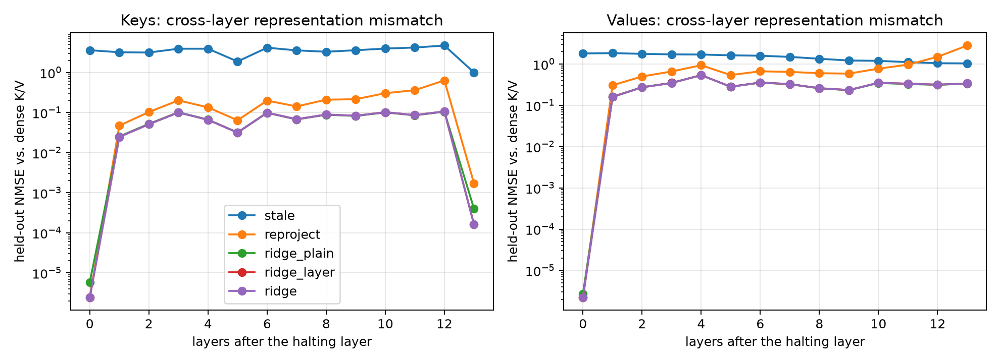
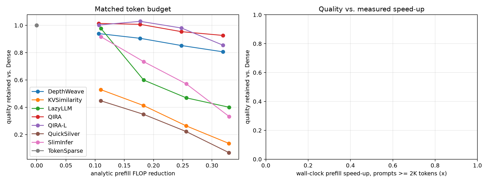
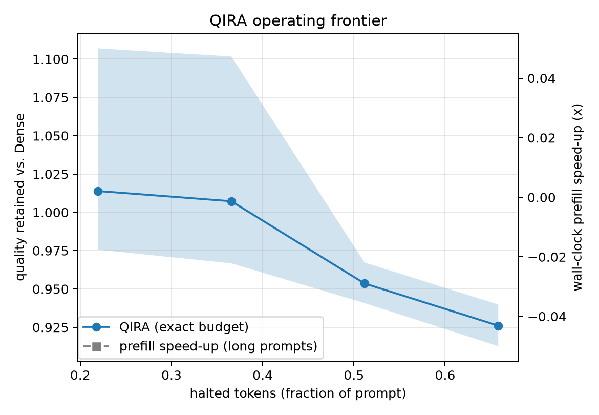

# QIRA report — Qwen2.5-7B-Instruct

Protocol `QIRA-v8-transport` · preset `paper` · calibration source `natural` · decision layer 14 / 28

QIRA is backbone-frozen and inference-time adaptive; its K/V transport maps are calibrated offline in closed form on a pool disjoint from all evaluation data.

## 1. The problem: cross-layer K/V mismatch (calibration hold-out)

Mean held-out NMSE of halted-token K/V over all layers after the halting layer (`ridge(sub)`/`mlp` are measured on the MLP subsample).

| policy      |   nmse_kv |
|:------------|----------:|
| stale       |    2.7578 |
| reproject   |    0.3322 |
| mlp         |    0.1410 |
| ridge(sub)  |    0.1235 |
| ridge_layer |    0.1232 |
| ridge       |    0.1231 |
| ridge_plain |    0.1225 |

Spearman correlation of each selector score with (a) low halting harm, harm = attention received x ridge transport error summed over layers >= d, and (b) transportability (−log ridge NMSE):

| selector              |   spearman_vs_low_harm |   spearman_vs_transportability |
|:----------------------|-----------------------:|-------------------------------:|
| qei                   |                  0.071 |                         -0.035 |
| qei_equal             |                  0.086 |                         -0.041 |
| qei_no_purity         |                  0.100 |                         -0.046 |
| qei_no_rank           |                  0.090 |                         -0.042 |
| qei_no_gap            |                  0.073 |                         -0.035 |
| qei_no_stability      |                  0.001 |                         -0.003 |
| qei_exact             |                  0.028 |                         -0.024 |
| cosine                |                  0.134 |                         -0.023 |
| normdelta             |                  0.098 |                         -0.105 |
| drift                 |                  0.017 |                          0.321 |
| lastattn              |                  0.198 |                          0.002 |
| relnorm               |                  0.006 |                         -0.183 |
| random                |                  0.010 |                         -0.003 |
| qei_fit               |                  0.119 |                         -0.052 |
| learned               |                  0.451 |                          0.123 |
| feature:purity        |                 -0.001 |                         -0.002 |
| feature:rank_score    |                 -0.001 |                         -0.002 |
| feature:gap           |                  0.019 |                         -0.011 |
| feature:stability     |                  0.122 |                         -0.055 |
| feature:cosine        |                  0.134 |                         -0.023 |
| feature:neg_normdelta |                  0.098 |                         -0.105 |
| feature:neg_drift     |                  0.017 |                          0.321 |
| feature:neg_relnorm   |                  0.006 |                         -0.183 |
| feature:neg_lastattn  |                  0.198 |                          0.002 |
| feature:rel_pos       |                  0.395 |                          0.062 |

## 2. Matched token-reduction budget

Dense: 2484 samples; mean Dense prefill 0.021s; engine-vs-HF KL (sanity) 1.94e-14.

| method       |   budget |    n |   halt_frac |   flop_reduction |   retention |   retention_lo |   retention_hi |   kl_last |   top1_agree |   fidelity |   speedup_long_median |
|:-------------|---------:|-----:|------------:|-----------------:|------------:|---------------:|---------------:|----------:|-------------:|-----------:|----------------------:|
| DepthWeave   |    0.300 | 2472 |       0.219 |            0.106 |       0.939 |          0.927 |          0.953 |     0.533 |        0.873 |      0.881 |                   nan |
| KVSimilarity |    0.300 | 2484 |       0.219 |            0.110 |       0.529 |          0.462 |          0.600 |     2.360 |        0.579 |      0.541 |                   nan |
| LazyLLM      |    0.300 | 2484 |       0.219 |            0.110 |       0.977 |          0.865 |          1.163 |     1.105 |        0.872 |      0.835 |                   nan |
| QIRA         |    0.300 | 2484 |       0.219 |            0.106 |       1.014 |          0.976 |          1.107 |     0.448 |        0.901 |      0.907 |                   nan |
| QIRA-L       |    0.300 | 2484 |       0.219 |            0.106 |       1.002 |          0.961 |          1.099 |     0.576 |        0.897 |      0.899 |                   nan |
| QuickSilver  |    0.300 | 2484 |       0.219 |            0.110 |       0.447 |          0.434 |          0.463 |     2.656 |        0.535 |      0.509 |                   nan |
| SlimInfer    |    0.300 | 2484 |       0.219 |            0.110 |       0.916 |          0.836 |          1.026 |     1.239 |        0.810 |      0.820 |                   nan |
| TokenSparse  |    0.300 | 2484 |       0.000 |            0.000 |       1.000 |          1.000 |          1.000 |     0.000 |        1.000 |      1.000 |                   nan |
| DepthWeave   |    0.500 | 2472 |       0.366 |            0.177 |       0.905 |          0.889 |          0.919 |     0.832 |        0.812 |      0.817 |                   nan |
| KVSimilarity |    0.500 | 2484 |       0.366 |            0.183 |       0.413 |          0.370 |          0.478 |     3.168 |        0.450 |      0.418 |                   nan |
| LazyLLM      |    0.500 | 2484 |       0.366 |            0.183 |       0.599 |          0.558 |          0.685 |     2.459 |        0.753 |      0.705 |                   nan |
| QIRA         |    0.500 | 2484 |       0.366 |            0.177 |       1.007 |          0.967 |          1.102 |     0.738 |        0.864 |      0.870 |                   nan |
| QIRA-L       |    0.500 | 2484 |       0.366 |            0.177 |       1.029 |          0.936 |          1.238 |     0.919 |        0.833 |      0.836 |                   nan |
| QuickSilver  |    0.500 | 2484 |       0.366 |            0.183 |       0.348 |          0.335 |          0.360 |     3.885 |        0.401 |      0.382 |                   nan |
| SlimInfer    |    0.500 | 2484 |       0.366 |            0.183 |       0.734 |          0.651 |          0.825 |     2.013 |        0.722 |      0.728 |                   nan |
| TokenSparse  |    0.500 | 2484 |       0.000 |            0.000 |       1.000 |          1.000 |          1.000 |     0.000 |        1.000 |      1.000 |                   nan |
| DepthWeave   |    0.700 | 2472 |       0.512 |            0.248 |       0.852 |          0.835 |          0.870 |     1.076 |        0.763 |      0.762 |                   nan |
| KVSimilarity |    0.700 | 2483 |       0.512 |            0.256 |       0.264 |          0.250 |          0.278 |     4.796 |        0.264 |      0.250 |                   nan |
| LazyLLM      |    0.700 | 2484 |       0.512 |            0.256 |       0.469 |          0.455 |          0.484 |     4.382 |        0.601 |      0.563 |                   nan |
| QIRA         |    0.700 | 2484 |       0.512 |            0.248 |       0.954 |          0.941 |          0.967 |     0.941 |        0.821 |      0.828 |                   nan |
| QIRA-L       |    0.700 | 2484 |       0.512 |            0.248 |       0.980 |          0.869 |          1.197 |     1.089 |        0.795 |      0.800 |                   nan |
| QuickSilver  |    0.700 | 2483 |       0.512 |            0.256 |       0.222 |          0.177 |          0.303 |     6.395 |        0.197 |      0.176 |                   nan |
| SlimInfer    |    0.700 | 2483 |       0.512 |            0.256 |       0.571 |          0.524 |          0.654 |     3.117 |        0.619 |      0.624 |                   nan |
| TokenSparse  |    0.700 | 2484 |       0.000 |            0.000 |       1.000 |          1.000 |          1.000 |     0.000 |        1.000 |      1.000 |                   nan |
| DepthWeave   |    0.900 | 2472 |       0.658 |            0.319 |       0.806 |          0.788 |          0.829 |     1.194 |        0.727 |      0.723 |                   nan |
| KVSimilarity |    0.900 | 2483 |       0.658 |            0.329 |       0.135 |          0.125 |          0.148 |     7.405 |        0.081 |      0.089 |                   nan |
| LazyLLM      |    0.900 | 2483 |       0.658 |            0.329 |       0.400 |          0.388 |          0.414 |     5.222 |        0.487 |      0.486 |                   nan |
| QIRA         |    0.900 | 2483 |       0.658 |            0.319 |       0.926 |          0.913 |          0.940 |     1.191 |        0.795 |      0.801 |                   nan |
| QIRA-L       |    0.900 | 2483 |       0.658 |            0.319 |       0.855 |          0.764 |          0.931 |     1.133 |        0.785 |      0.794 |                   nan |
| QuickSilver  |    0.900 | 2483 |       0.658 |            0.329 |       0.068 |          0.058 |          0.078 |     8.672 |        0.028 |      0.025 |                   nan |
| SlimInfer    |    0.900 | 2483 |       0.658 |            0.329 |       0.332 |          0.318 |          0.349 |     7.705 |        0.191 |      0.193 |                   nan |
| TokenSparse  |    0.900 | 2483 |       0.000 |            0.000 |       1.000 |          1.000 |          1.000 |     0.000 |        1.000 |      1.000 |                   nan |

## 3. Matched quality (accuracy-matched efficiency)

Largest efficiency at which each method still retains the target fraction of Dense quality (linear interpolation along the budget sweep; `saturated` = target still met at the largest budget tested, so the value is a lower bound).

| method       |   target |   flop_reduction |   halt_frac |   speedup_long_median | reached   | saturated   |
|:-------------|---------:|-----------------:|------------:|----------------------:|:----------|:------------|
| DepthWeave   |    0.990 |            0.000 |       0.000 |                 0.000 | False     | False       |
| DepthWeave   |    0.970 |            0.000 |       0.000 |                 0.000 | False     | False       |
| DepthWeave   |    0.950 |            0.000 |       0.000 |                 0.000 | False     | False       |
| DepthWeave   |    0.900 |            0.184 |       0.379 |               nan     | True      | False       |
| DepthWeave   |    0.850 |            0.251 |       0.518 |               nan     | True      | False       |
| KVSimilarity |    0.990 |            0.000 |       0.000 |                 0.000 | False     | False       |
| KVSimilarity |    0.970 |            0.000 |       0.000 |                 0.000 | False     | False       |
| KVSimilarity |    0.950 |            0.000 |       0.000 |                 0.000 | False     | False       |
| KVSimilarity |    0.900 |            0.000 |       0.000 |                 0.000 | False     | False       |
| KVSimilarity |    0.850 |            0.000 |       0.000 |                 0.000 | False     | False       |
| LazyLLM      |    0.990 |            0.000 |       0.000 |                 0.000 | False     | False       |
| LazyLLM      |    0.970 |            0.111 |       0.222 |               nan     | True      | False       |
| LazyLLM      |    0.950 |            0.115 |       0.230 |               nan     | True      | False       |
| LazyLLM      |    0.900 |            0.125 |       0.249 |               nan     | True      | False       |
| LazyLLM      |    0.850 |            0.135 |       0.269 |               nan     | True      | False       |
| QIRA         |    0.990 |            0.200 |       0.413 |               nan     | True      | False       |
| QIRA         |    0.970 |            0.226 |       0.467 |               nan     | True      | False       |
| QIRA         |    0.950 |            0.257 |       0.531 |               nan     | True      | False       |
| QIRA         |    0.900 |            0.319 |       0.658 |               nan     | True      | True        |
| QIRA         |    0.850 |            0.319 |       0.658 |               nan     | True      | True        |
| QIRA-L       |    0.990 |            0.234 |       0.483 |               nan     | True      | False       |
| QIRA-L       |    0.970 |            0.254 |       0.524 |               nan     | True      | False       |
| QIRA-L       |    0.950 |            0.265 |       0.547 |               nan     | True      | False       |
| QIRA-L       |    0.900 |            0.293 |       0.605 |               nan     | True      | False       |
| QIRA-L       |    0.850 |            0.319 |       0.658 |               nan     | True      | True        |
| QuickSilver  |    0.990 |            0.000 |       0.000 |                 0.000 | False     | False       |
| QuickSilver  |    0.970 |            0.000 |       0.000 |                 0.000 | False     | False       |
| QuickSilver  |    0.950 |            0.000 |       0.000 |                 0.000 | False     | False       |
| QuickSilver  |    0.900 |            0.000 |       0.000 |                 0.000 | False     | False       |
| QuickSilver  |    0.850 |            0.000 |       0.000 |                 0.000 | False     | False       |
| SlimInfer    |    0.990 |            0.000 |       0.000 |                 0.000 | False     | False       |
| SlimInfer    |    0.970 |            0.000 |       0.000 |                 0.000 | False     | False       |
| SlimInfer    |    0.950 |            0.000 |       0.000 |                 0.000 | False     | False       |
| SlimInfer    |    0.900 |            0.116 |       0.232 |               nan     | True      | False       |
| SlimInfer    |    0.850 |            0.137 |       0.273 |               nan     | True      | False       |
| TokenSparse  |    0.990 |            0.000 |       0.000 |               nan     | True      | True        |
| TokenSparse  |    0.970 |            0.000 |       0.000 |               nan     | True      | True        |
| TokenSparse  |    0.950 |            0.000 |       0.000 |               nan     | True      | True        |
| TokenSparse  |    0.900 |            0.000 |       0.000 |               nan     | True      | True        |
| TokenSparse  |    0.850 |            0.000 |       0.000 |               nan     | True      | True        |

## 4. QIRA operating frontier

_(not run)_

## 4b. Decomposition: plugging QIRA transport into baseline selectors (`+T` = same selector, ridge transport); QIRA vs QIRA-L = QEI vs learned selector

|   budget | base   | variant   |   retention_base |   retention_variant |   kl_base |   kl_variant |
|---------:|:-------|:----------|-----------------:|--------------------:|----------:|-------------:|
|    0.300 | QIRA   | QIRA-L    |            1.014 |               1.002 |     0.448 |        0.576 |
|    0.500 | QIRA   | QIRA-L    |            1.007 |               1.029 |     0.738 |        0.919 |
|    0.700 | QIRA   | QIRA-L    |            0.954 |               0.980 |     0.941 |        1.089 |
|    0.900 | QIRA   | QIRA-L    |            0.926 |               0.855 |     1.191 |        1.133 |

## Metric definitions

* `halt_frac`: halted tokens / prompt tokens (token reduction).
* `token_layer_reduction`: fraction of (token, layer) pairs skipped.
* `flop_reduction`: analytic prefill FLOPs incl. causal attention and transport overhead.
* `speedup_*`: wall-clock prefill time of the Dense engine / method on the same sample (CUDA-synchronised; TTFT = prefill + first-token selection).
* `kl_last`: KL(Dense || method) of the next-token distribution after the prompt.
* `ans_nll_delta`: change in teacher-forced NLL of the reference answer.
* `fidelity`: ROUGE-L between the method's and Dense's generations.
