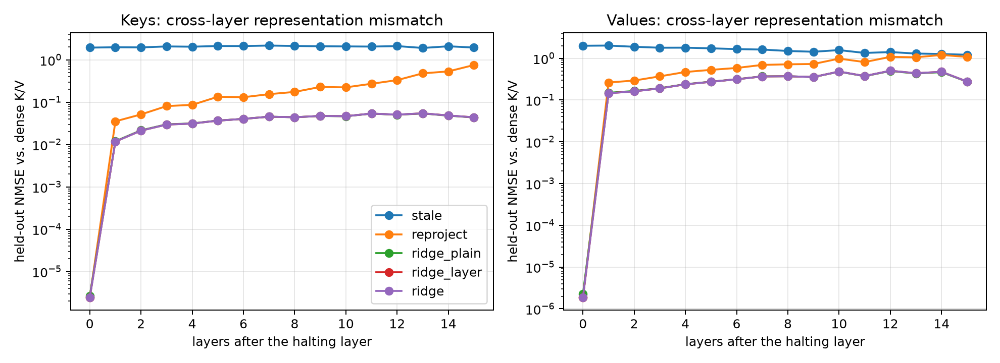
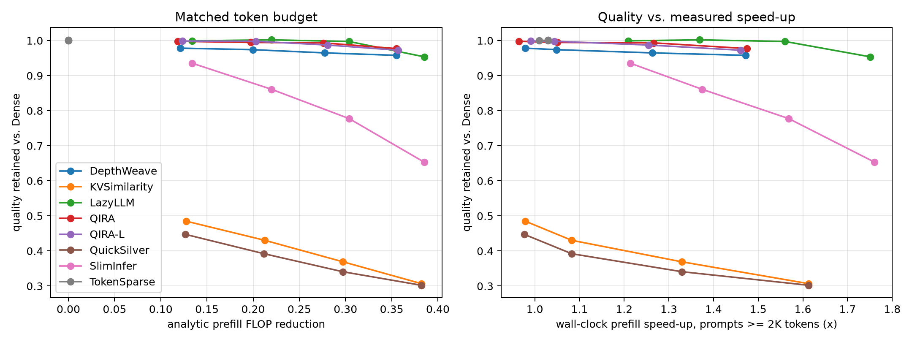
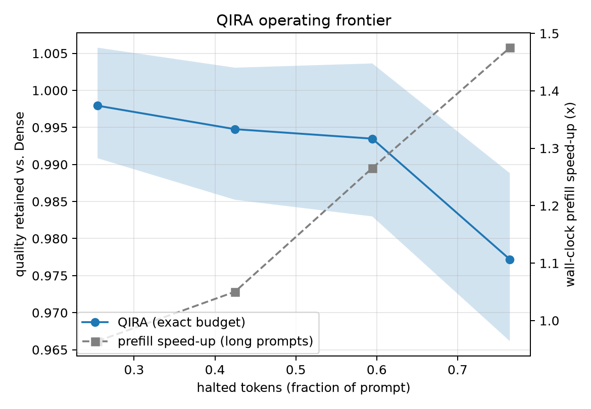
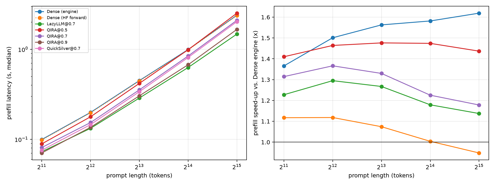

# QIRA report — Llama-3.1-8B-Instruct

Protocol `QIRA-v8-transport` · preset `paper` · calibration source `natural` · decision layer 16 / 32

QIRA is backbone-frozen and inference-time adaptive; its K/V transport maps are calibrated offline in closed form on a pool disjoint from all evaluation data.

## 1. The problem: cross-layer K/V mismatch (calibration hold-out)

Mean held-out NMSE of halted-token K/V over all layers after the halting layer (`ridge(sub)`/`mlp` are measured on the MLP subsample).

| policy      |   nmse_kv |
|:------------|----------:|
| stale       |    2.0372 |
| reproject   |    0.2468 |
| mlp         |    0.0548 |
| ridge(sub)  |    0.0486 |
| ridge_layer |    0.0483 |
| ridge       |    0.0483 |
| ridge_plain |    0.0482 |

Spearman correlation of each selector score with (a) low halting harm, harm = attention received x ridge transport error summed over layers >= d, and (b) transportability (−log ridge NMSE):

| selector              |   spearman_vs_low_harm |   spearman_vs_transportability |
|:----------------------|-----------------------:|-------------------------------:|
| qei                   |                  0.154 |                          0.093 |
| qei_equal             |                  0.179 |                          0.108 |
| qei_no_purity         |                  0.200 |                          0.118 |
| qei_no_rank           |                  0.186 |                          0.111 |
| qei_no_gap            |                  0.165 |                          0.100 |
| qei_no_stability      |                  0.006 |                          0.008 |
| qei_exact             |                  0.088 |                          0.052 |
| cosine                |                  0.247 |                          0.162 |
| normdelta             |                  0.222 |                          0.094 |
| drift                 |                 -0.004 |                          0.250 |
| lastattn              |                  0.391 |                          0.182 |
| relnorm               |                 -0.089 |                         -0.315 |
| random                |                  0.008 |                          0.003 |
| qei_fit               |                  0.242 |                          0.138 |
| learned               |                  0.547 |                          0.235 |
| feature:purity        |                  0.009 |                          0.009 |
| feature:rank_score    |                  0.009 |                          0.009 |
| feature:gap           |                  0.001 |                          0.001 |
| feature:stability     |                  0.242 |                          0.138 |
| feature:cosine        |                  0.247 |                          0.162 |
| feature:neg_normdelta |                  0.222 |                          0.094 |
| feature:neg_drift     |                 -0.004 |                          0.250 |
| feature:neg_relnorm   |                 -0.089 |                         -0.315 |
| feature:neg_lastattn  |                  0.391 |                          0.182 |
| feature:rel_pos       |                  0.415 |                          0.100 |

## 2. Matched token-reduction budget

Dense: 5690 samples; mean Dense prefill 0.209s; engine-vs-HF KL (sanity) nan.

| method       |   budget |    n |   halt_frac |   flop_reduction |   retention |   retention_lo |   retention_hi |   kl_last |   top1_agree |   fidelity |   speedup_long_median |
|:-------------|---------:|-----:|------------:|-----------------:|------------:|---------------:|---------------:|----------:|-------------:|-----------:|----------------------:|
| DepthWeave   |    0.300 | 5690 |       0.255 |            0.121 |       0.978 |          0.971 |          0.987 |     0.040 |        0.944 |      0.870 |                 0.979 |
| KVSimilarity |    0.300 | 5690 |       0.255 |            0.128 |       0.485 |          0.469 |          0.500 |     2.673 |        0.427 |      0.129 |                 0.979 |
| LazyLLM      |    0.300 | 5690 |       0.255 |            0.134 |       0.999 |          0.996 |          1.002 |     0.001 |        0.990 |      0.958 |                 1.209 |
| QIRA         |    0.300 | 5690 |       0.255 |            0.119 |       0.998 |          0.991 |          1.006 |     0.018 |        0.963 |      0.910 |                 0.964 |
| QIRA-L       |    0.300 | 5690 |       0.255 |            0.123 |       0.999 |          0.995 |          1.002 |     0.002 |        0.986 |      0.955 |                 0.991 |
| QuickSilver  |    0.300 | 5690 |       0.255 |            0.127 |       0.447 |          0.432 |          0.463 |     2.953 |        0.364 |      0.163 |                 0.977 |
| SlimInfer    |    0.300 | 5690 |       0.255 |            0.134 |       0.936 |          0.925 |          0.947 |     0.245 |        0.889 |      0.769 |                 1.213 |
| TokenSparse  |    0.300 | 5690 |       0.000 |            0.000 |       1.001 |          0.996 |          1.005 |     0.039 |        0.956 |      0.858 |                 1.009 |
| DepthWeave   |    0.500 | 5690 |       0.425 |            0.200 |       0.974 |          0.966 |          0.984 |     0.067 |        0.920 |      0.833 |                 1.049 |
| KVSimilarity |    0.500 | 5690 |       0.425 |            0.212 |       0.430 |          0.416 |          0.446 |     2.982 |        0.394 |      0.088 |                 1.082 |
| LazyLLM      |    0.500 | 5690 |       0.425 |            0.220 |       1.002 |          0.999 |          1.006 |     0.003 |        0.986 |      0.936 |                 1.369 |
| QIRA         |    0.500 | 5690 |       0.425 |            0.197 |       0.995 |          0.985 |          1.003 |     0.033 |        0.947 |      0.876 |                 1.050 |
| QIRA-L       |    0.500 | 5690 |       0.425 |            0.203 |       0.998 |          0.992 |          1.004 |     0.006 |        0.980 |      0.938 |                 1.043 |
| QuickSilver  |    0.500 | 5690 |       0.425 |            0.212 |       0.392 |          0.377 |          0.409 |     3.315 |        0.344 |      0.126 |                 1.083 |
| SlimInfer    |    0.500 | 5690 |       0.425 |            0.220 |       0.861 |          0.846 |          0.877 |     0.597 |        0.818 |      0.676 |                 1.375 |
| TokenSparse  |    0.500 | 5690 |       0.000 |            0.000 |       1.001 |          0.996 |          1.005 |     0.038 |        0.955 |      0.857 |                 1.030 |
| DepthWeave   |    0.700 | 5690 |       0.595 |            0.278 |       0.965 |          0.955 |          0.977 |     0.103 |        0.894 |      0.790 |                 1.263 |
| KVSimilarity |    0.700 | 5690 |       0.595 |            0.297 |       0.369 |          0.357 |          0.386 |     3.337 |        0.364 |      0.080 |                 1.329 |
| LazyLLM      |    0.700 | 5690 |       0.595 |            0.304 |       0.997 |          0.992 |          1.004 |     0.009 |        0.974 |      0.902 |                 1.560 |
| QIRA         |    0.700 | 5690 |       0.595 |            0.276 |       0.993 |          0.983 |          1.004 |     0.060 |        0.924 |      0.823 |                 1.266 |
| QIRA-L       |    0.700 | 5690 |       0.595 |            0.281 |       0.987 |          0.980 |          0.995 |     0.021 |        0.960 |      0.905 |                 1.255 |
| QuickSilver  |    0.700 | 5690 |       0.595 |            0.297 |       0.341 |          0.329 |          0.356 |     3.607 |        0.330 |      0.124 |                 1.329 |
| SlimInfer    |    0.700 | 5690 |       0.595 |            0.304 |       0.778 |          0.762 |          0.795 |     0.957 |        0.745 |      0.584 |                 1.568 |
| TokenSparse  |    0.700 | 5690 |       0.000 |            0.000 |       1.001 |          0.996 |          1.005 |     0.037 |        0.955 |      0.858 |                 1.030 |
| DepthWeave   |    0.900 | 5690 |       0.765 |            0.355 |       0.958 |          0.946 |          0.970 |     0.152 |        0.861 |      0.738 |                 1.472 |
| KVSimilarity |    0.900 | 5690 |       0.765 |            0.382 |       0.307 |          0.293 |          0.320 |     3.788 |        0.316 |      0.074 |                 1.613 |
| LazyLLM      |    0.900 | 5690 |       0.765 |            0.385 |       0.954 |          0.943 |          0.965 |     0.126 |        0.930 |      0.802 |                 1.750 |
| QIRA         |    0.900 | 5690 |       0.765 |            0.355 |       0.977 |          0.966 |          0.989 |     0.099 |        0.904 |      0.780 |                 1.475 |
| QIRA-L       |    0.900 | 5690 |       0.765 |            0.357 |       0.973 |          0.962 |          0.984 |     0.056 |        0.936 |      0.848 |                 1.461 |
| QuickSilver  |    0.900 | 5690 |       0.765 |            0.382 |       0.302 |          0.291 |          0.315 |     3.840 |        0.312 |      0.100 |                 1.613 |
| SlimInfer    |    0.900 | 5690 |       0.765 |            0.385 |       0.653 |          0.636 |          0.671 |     1.416 |        0.671 |      0.474 |                 1.760 |
| TokenSparse  |    0.900 | 5690 |       0.000 |            0.000 |       1.001 |          0.996 |          1.005 |     0.037 |        0.955 |      0.858 |                 1.030 |

## 3. Matched quality (accuracy-matched efficiency)

Largest efficiency at which each method still retains the target fraction of Dense quality (linear interpolation along the budget sweep; `saturated` = target still met at the largest budget tested, so the value is a lower bound).

| method       |   target |   flop_reduction |   halt_frac |   speedup_long_median | reached   | saturated   |
|:-------------|---------:|-----------------:|------------:|----------------------:|:----------|:------------|
| DepthWeave   |    0.990 |            0.000 |       0.000 |                 0.000 | False     | False       |
| DepthWeave   |    0.970 |            0.234 |       0.500 |                 1.144 | True      | False       |
| DepthWeave   |    0.950 |            0.355 |       0.765 |                 1.472 | True      | True        |
| DepthWeave   |    0.900 |            0.355 |       0.765 |                 1.472 | True      | True        |
| DepthWeave   |    0.850 |            0.355 |       0.765 |                 1.472 | True      | True        |
| KVSimilarity |    0.990 |            0.000 |       0.000 |                 0.000 | False     | False       |
| KVSimilarity |    0.970 |            0.000 |       0.000 |                 0.000 | False     | False       |
| KVSimilarity |    0.950 |            0.000 |       0.000 |                 0.000 | False     | False       |
| KVSimilarity |    0.900 |            0.000 |       0.000 |                 0.000 | False     | False       |
| KVSimilarity |    0.850 |            0.000 |       0.000 |                 0.000 | False     | False       |
| LazyLLM      |    0.990 |            0.318 |       0.624 |                 1.593 | True      | False       |
| LazyLLM      |    0.970 |            0.355 |       0.701 |                 1.680 | True      | False       |
| LazyLLM      |    0.950 |            0.385 |       0.765 |                 1.750 | True      | True        |
| LazyLLM      |    0.900 |            0.385 |       0.765 |                 1.750 | True      | True        |
| LazyLLM      |    0.850 |            0.385 |       0.765 |                 1.750 | True      | True        |
| QIRA         |    0.990 |            0.293 |       0.631 |                 1.310 | True      | False       |
| QIRA         |    0.970 |            0.355 |       0.765 |                 1.475 | True      | True        |
| QIRA         |    0.950 |            0.355 |       0.765 |                 1.475 | True      | True        |
| QIRA         |    0.900 |            0.355 |       0.765 |                 1.475 | True      | True        |
| QIRA         |    0.850 |            0.355 |       0.765 |                 1.475 | True      | True        |
| QIRA-L       |    0.990 |            0.261 |       0.552 |                 1.202 | True      | False       |
| QIRA-L       |    0.970 |            0.357 |       0.765 |                 1.461 | True      | True        |
| QIRA-L       |    0.950 |            0.357 |       0.765 |                 1.461 | True      | True        |
| QIRA-L       |    0.900 |            0.357 |       0.765 |                 1.461 | True      | True        |
| QIRA-L       |    0.850 |            0.357 |       0.765 |                 1.461 | True      | True        |
| QuickSilver  |    0.990 |            0.000 |       0.000 |                 0.000 | False     | False       |
| QuickSilver  |    0.970 |            0.000 |       0.000 |                 0.000 | False     | False       |
| QuickSilver  |    0.950 |            0.000 |       0.000 |                 0.000 | False     | False       |
| QuickSilver  |    0.900 |            0.000 |       0.000 |                 0.000 | False     | False       |
| QuickSilver  |    0.850 |            0.000 |       0.000 |                 0.000 | False     | False       |
| SlimInfer    |    0.990 |            0.000 |       0.000 |                 0.000 | False     | False       |
| SlimInfer    |    0.970 |            0.000 |       0.000 |                 0.000 | False     | False       |
| SlimInfer    |    0.950 |            0.000 |       0.000 |                 0.000 | False     | False       |
| SlimInfer    |    0.900 |            0.175 |       0.336 |                 1.290 | True      | False       |
| SlimInfer    |    0.850 |            0.231 |       0.447 |                 1.400 | True      | False       |
| TokenSparse  |    0.990 |            0.000 |       0.000 |                 1.009 | True      | True        |
| TokenSparse  |    0.970 |            0.000 |       0.000 |                 1.009 | True      | True        |
| TokenSparse  |    0.950 |            0.000 |       0.000 |                 1.009 | True      | True        |
| TokenSparse  |    0.900 |            0.000 |       0.000 |                 1.009 | True      | True        |
| TokenSparse  |    0.850 |            0.000 |       0.000 |                 1.009 | True      | True        |

## 4. QIRA operating frontier

_(not run)_

## 4b. Decomposition: plugging QIRA transport into baseline selectors (`+T` = same selector, ridge transport); QIRA vs QIRA-L = QEI vs learned selector

|   budget | base   | variant   |   retention_base |   retention_variant |   kl_base |   kl_variant |
|---------:|:-------|:----------|-----------------:|--------------------:|----------:|-------------:|
|    0.300 | QIRA   | QIRA-L    |            0.998 |               0.999 |     0.018 |        0.002 |
|    0.500 | QIRA   | QIRA-L    |            0.995 |               0.998 |     0.033 |        0.006 |
|    0.700 | QIRA   | QIRA-L    |            0.993 |               0.987 |     0.060 |        0.021 |
|    0.900 | QIRA   | QIRA-L    |            0.977 |               0.973 |     0.099 |        0.056 |

## 8. Context scaling (needle retrieval; latency = median of repeats after warm-up)

|   target_len |   dense_prefill |   hf_prefill |   dense_mem |   dense_needle_acc |
|-------------:|----------------:|-------------:|------------:|-------------------:|
|     2048.000 |           0.100 |        0.098 |      16.938 |              1.000 |
|     4096.000 |           0.199 |        0.197 |      17.725 |              1.000 |
|     8192.000 |           0.449 |        0.445 |      19.308 |              1.000 |
|    16384.000 |           0.994 |        0.985 |      22.469 |              1.000 |
|    32768.000 |           2.393 |        2.376 |      28.788 |              1.000 |

|   target_len | method      |   budget |   n |   prompt_tokens |   prefill_s |   prefill_dense |   speedup |   flop_reduction |   peak_mem_gb |   needle_acc |   kl_last |
|-------------:|:------------|---------:|----:|----------------:|------------:|----------------:|----------:|-----------------:|--------------:|-------------:|----------:|
|         2048 | LazyLLM     |    0.700 |   3 |        1995.667 |       0.073 |           0.100 |     1.366 |            0.348 |        16.923 |        1.000 |     0.000 |
|         2048 | QIRA        |    0.500 |   3 |        1995.667 |       0.089 |           0.100 |     1.117 |            0.228 |        16.923 |        1.000 |     0.000 |
|         2048 | QIRA        |    0.700 |   3 |        1995.667 |       0.081 |           0.100 |     1.228 |            0.319 |        16.923 |        1.000 |     0.000 |
|         2048 | QIRA        |    0.900 |   3 |        1995.667 |       0.071 |           0.100 |     1.410 |            0.410 |        16.923 |        1.000 |     0.000 |
|         2048 | QuickSilver |    0.700 |   3 |        1995.667 |       0.076 |           0.100 |     1.315 |            0.344 |        16.923 |        0.000 |     8.664 |
|         4096 | LazyLLM     |    0.700 |   3 |        4044.000 |       0.133 |           0.199 |     1.501 |            0.355 |        17.693 |        1.000 |     0.000 |
|         4096 | QIRA        |    0.500 |   3 |        4044.000 |       0.178 |           0.199 |     1.118 |            0.231 |        17.693 |        1.000 |     0.001 |
|         4096 | QIRA        |    0.700 |   3 |        4044.000 |       0.154 |           0.199 |     1.295 |            0.323 |        17.693 |        1.000 |     0.000 |
|         4096 | QIRA        |    0.900 |   3 |        4044.000 |       0.136 |           0.199 |     1.464 |            0.415 |        17.693 |        1.000 |     0.000 |
|         4096 | QuickSilver |    0.700 |   3 |        4044.000 |       0.146 |           0.199 |     1.366 |            0.347 |        17.693 |        0.000 |    11.043 |
|         8192 | LazyLLM     |    0.700 |   3 |        8140.000 |       0.288 |           0.449 |     1.563 |            0.363 |        19.245 |        1.000 |     0.000 |
|         8192 | QIRA        |    0.500 |   3 |        8140.000 |       0.418 |           0.449 |     1.074 |            0.233 |        19.245 |        1.000 |     0.000 |
|         8192 | QIRA        |    0.700 |   3 |        8140.000 |       0.355 |           0.449 |     1.267 |            0.326 |        19.245 |        1.000 |     0.000 |
|         8192 | QIRA        |    0.900 |   3 |        8140.000 |       0.304 |           0.449 |     1.476 |            0.419 |        19.245 |        1.000 |     0.000 |
|         8192 | QuickSilver |    0.700 |   3 |        8140.000 |       0.338 |           0.449 |     1.330 |            0.350 |        19.245 |        0.000 |     8.432 |
|        16384 | LazyLLM     |    0.700 |   3 |       16332.000 |       0.628 |           0.994 |     1.582 |            0.374 |        22.343 |        1.000 |     0.000 |
|        16384 | QIRA        |    0.500 |   3 |       16332.000 |       0.990 |           0.994 |     1.004 |            0.237 |        22.343 |        1.000 |     0.000 |
|        16384 | QIRA        |    0.700 |   3 |       16332.000 |       0.843 |           0.994 |     1.179 |            0.331 |        22.343 |        1.000 |     0.000 |
|        16384 | QIRA        |    0.900 |   3 |       16332.000 |       0.674 |           0.994 |     1.474 |            0.424 |        22.343 |        1.000 |     0.000 |
|        16384 | QuickSilver |    0.700 |   3 |       16332.000 |       0.812 |           0.994 |     1.225 |            0.351 |        22.343 |        0.000 |     7.753 |
|        32768 | LazyLLM     |    0.700 |   3 |       32716.000 |       1.478 |           2.393 |     1.619 |            0.390 |        28.539 |        1.000 |     0.000 |
|        32768 | QIRA        |    0.500 |   3 |       32716.000 |       2.522 |           2.393 |     0.948 |            0.241 |        28.539 |        1.000 |     0.000 |
|        32768 | QIRA        |    0.700 |   3 |       32716.000 |       2.102 |           2.393 |     1.137 |            0.335 |        28.539 |        1.000 |     0.000 |
|        32768 | QIRA        |    0.900 |   3 |       32716.000 |       1.665 |           2.393 |     1.437 |            0.429 |        28.539 |        1.000 |     0.000 |
|        32768 | QuickSilver |    0.700 |   3 |       32716.000 |       2.029 |           2.393 |     1.178 |            0.351 |        28.539 |        0.000 |     6.677 |

## Metric definitions

* `halt_frac`: halted tokens / prompt tokens (token reduction).
* `token_layer_reduction`: fraction of (token, layer) pairs skipped.
* `flop_reduction`: analytic prefill FLOPs incl. causal attention and transport overhead.
* `speedup_*`: wall-clock prefill time of the Dense engine / method on the same sample (CUDA-synchronised; TTFT = prefill + first-token selection).
* `kl_last`: KL(Dense || method) of the next-token distribution after the prompt.
* `ans_nll_delta`: change in teacher-forced NLL of the reference answer.
* `fidelity`: ROUGE-L between the method's and Dense's generations.
